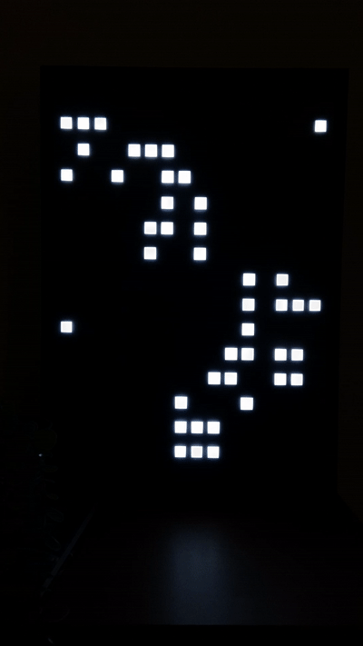
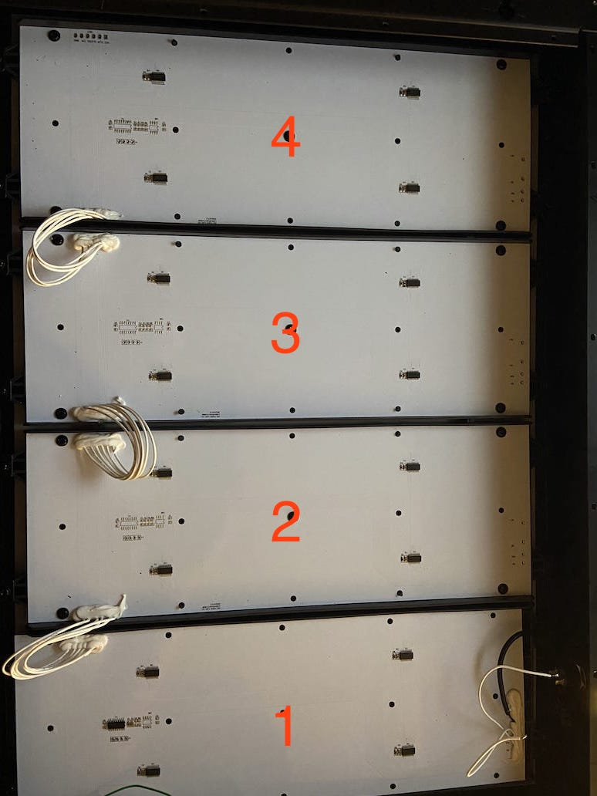
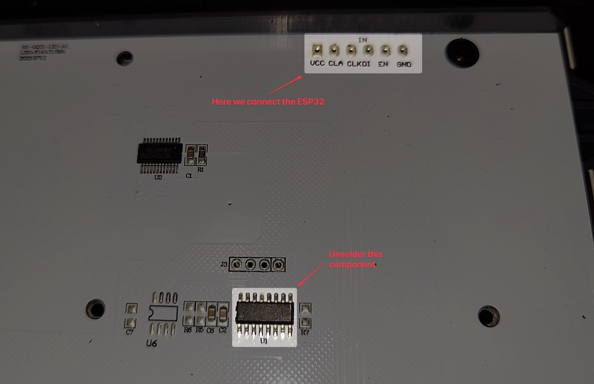
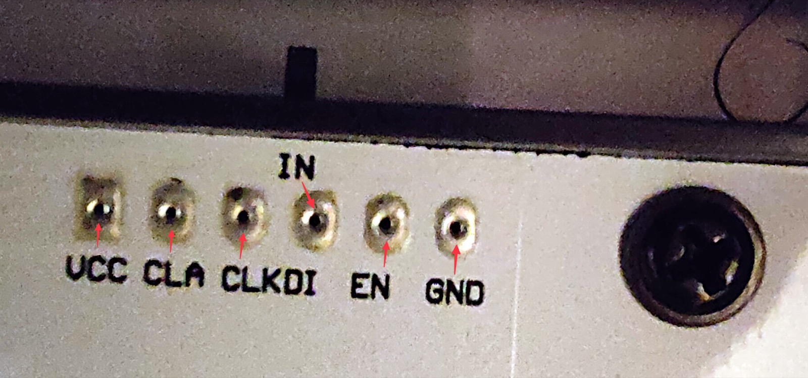
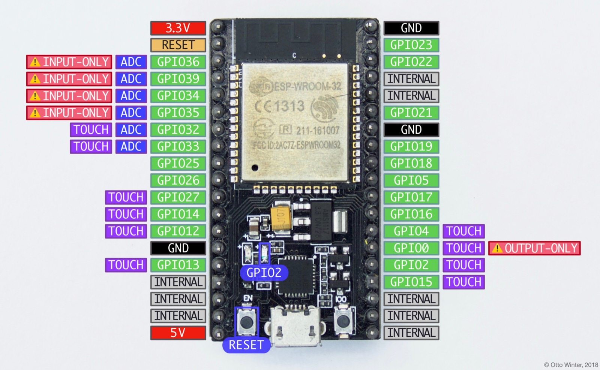

# IKEA OBEGRÄNSAD Hack/Mod

Replace the controller of the IKEA OBEGRÄNSAD LED wall lamp with an ESP32 or ESP8266 and turn it into a Wi-Fi
connected 16×16 pixel display: 40+ plugins, a web interface for live drawing, an HTTP and WebSocket API, MQTT with
Home Assistant discovery, DDP and Art-Net.

**[📖 Documentation](https://ph1p.github.io/ikea-led-obegraensad/)** · [Hardware](https://ph1p.github.io/ikea-led-obegraensad/getting-started/hardware) · [Home Assistant](https://ph1p.github.io/ikea-led-obegraensad/integrations/home-assistant) · [HTTP API](https://ph1p.github.io/ikea-led-obegraensad/reference/http-api) · [Releases](https://github.com/ph1p/ikea-led-obegraensad/releases)

> [!WARNING]
> Use this code and these instructions at your own risk. Opening the lamp voids its warranty, and improper wiring
> can damage the device. Always unplug the lamp before you open it.

<p align="center">
  
</p>

## Features

- **Web GUI** to draw live, import images, build animations, rotate the display and change settings
- **42 plugins**: clocks (Pong, Smoke, Fractal, Big Clock), weather, games (Snake, Tetris, Breakout, Flappy Bird,
  Space Invaders), Game of Life, falling sand, fireworks, animations and more
- **Plugin scheduler** that switches plugins every _n_ seconds, also from the hardware button
- **Scheduled brightness** to dim the display at night, plus a display on/off switch
- **Home Assistant** via MQTT discovery: light, plugin select, message text, schedule switch and more
- **Scrolling messages and small graphs** from any script or automation
- **DDP and Art-Net** to stream frames from xLights, LedFx or your own scripts
- **OTA updates** and Wi-Fi setup through a captive portal

## Quick start

1. **Open the lamp** and wire a microcontroller to the input pads of the lowest panel. Remove the original
   controller chip (U1). See [Hardware](https://ph1p.github.io/ikea-led-obegraensad/getting-started/hardware).
2. **Flash the firmware** with [PlatformIO](https://platformio.org/):

   ```bash
   git clone https://github.com/ph1p/ikea-led-obegraensad.git
   cd ikea-led-obegraensad
   pio run -e esp32dev -t upload
   ```

   Other boards: `esp32c3`, `esp32s3`, `ESP32-wemos`, `nodemcuv2`, `d1_mini`, `d1_mini_pro-ota`.
   See [Flashing](https://ph1p.github.io/ikea-led-obegraensad/getting-started/flashing).

3. **Connect to Wi-Fi.** On first boot the ESP32 opens a network called `IKEA`. Join it and pick your Wi-Fi in the
   captive portal. ESP8266 boards read the credentials from `include/secrets.h`.
   See [Wi-Fi setup](https://ph1p.github.io/ikea-led-obegraensad/getting-started/wifi).
4. **Open the Web GUI** at the IP address of the lamp. You find it in the serial monitor or your router.

https://github.com/user-attachments/assets/ddf91be1-2c95-4adc-b178-05b0781683cc

## Hardware

Inside the lamp are four panels with 64 LEDs each. Only the lowest panel (1) matters: it has six input pads at the
top edge and the original controller (U1) at the bottom, which you unsolder.

<p>
  
  
</p>



|      Panel       | ESP32  | ESP32-C3 | TTGO LoRa32 | NodeMCUv2 | Wemos D1 mini | Lolin D32 (Pro) | Xiao ESP32S3 |
| :--------------: | :----: | :------: | :---------: | :-------: | :-----------: | :-------------: | :----------: |
|       GND        |  GND   |   GND    |     GND     |    GND    |      GND      |       GND       |     GND      |
|       VCC        |   5V   |    5V    |     5V      |    VIN    |      5V       |       USB       |     VUSB     |
| EN (PIN_ENABLE)  | GPIO26 |  GPIO3   |    IO22     | GPIO16 D0 |   GPIO16 D0   |     GPIO26      |  D4 (GPIO5)  |
|  IN (PIN_DATA)   | GPIO27 |  GPIO4   |    IO23     | GPIO13 D7 |   GPIO13 D7   |     GPIO27      |  D10 (MOSI)  |
| CLK (PIN_CLOCK)  | GPIO14 |  GPIO5   |    IO02     | GPIO14 D5 |   GPIO14 D5   |     GPIO14      |   D8 (SCK)   |
| CLA (PIN_LATCH)  | GPIO12 |  GPIO6   |    IO15     | GPIO0 D3  |   GPIO0 D3    |     GPIO12      |  D5 (GPIO6)  |
|  BUTTON one end  | GPIO16 |  GPIO7   |    IO21     | GPIO2 D4  |   GPIO2 D4    |     GPIO25      |  D3 (GPIO4)  |
| BUTTON other end |  GND   |   GND    |     GND     |    GND    |      GND      |       GND       |     GND      |

Pins are set in `include/constants.h`. The original button can also be used without extra wires, see
[issue #79](https://github.com/ph1p/ikea-led-obegraensad/issues/79).

<details>
  <summary>ESP32 dev board pinout</summary>
  
</details>

## Home Assistant

Open **Settings → MQTT / Home Assistant** in the Web GUI, enter your broker and save. With discovery on, the lamp
appears in Home Assistant as the device `OBEGRÄNSAD LED`, no YAML needed.

You can also use the [HACS integration](https://github.com/HennieLP/ikea-led-obegraensad-Home-Assistant-Integration)
(websocket, no broker) or `rest_command` with the HTTP API. All three are described in the
[Home Assistant guide](https://ph1p.github.io/ikea-led-obegraensad/integrations/home-assistant).

## API

Everything the Web GUI does is available over HTTP, WebSocket and MQTT:

```bash
curl http://your-lamp/api/info                              # state, plugins, brightness
curl -X PATCH "http://your-lamp/api/plugin?id=7"            # switch plugin
curl -X PATCH "http://your-lamp/api/brightness?value=100"   # 0-255
curl -X PATCH "http://your-lamp/api/power?state=off"        # on, off, toggle
curl "http://your-lamp/api/message?text=Hello&repeat=3"     # scrolling message
```

### Full reference

- [HTTP API](https://ph1p.github.io/ikea-led-obegraensad/reference/http-api)
- [WebSocket](https://ph1p.github.io/ikea-led-obegraensad/reference/websocket)
- [MQTT](https://ph1p.github.io/ikea-led-obegraensad/integrations/mqtt)
- [DDP](https://ph1p.github.io/ikea-led-obegraensad/integrations/ddp)
- [Art-Net](https://ph1p.github.io/ikea-led-obegraensad/integrations/artnet)

## Troubleshooting

The display flickers, stays black or the board reboots in a loop? Usually the supply voltage drops. Power the
matrix and the microcontroller from separate 5 V sources with a common ground. More in
[Troubleshooting](https://ph1p.github.io/ikea-led-obegraensad/troubleshooting).

## Development

| Path        | Contents                                                     |
| ----------- | ------------------------------------------------------------ |
| `src/`      | firmware (C++, PlatformIO)                                   |
| `include/`  | headers, plugins and `constants.h` with pins and features    |
| `frontend/` | Web GUI (SolidJS); `pnpm build` regenerates `src/webgui.cpp` |
| `docs/`     | this documentation (Vocs); `pnpm dev` for a local preview    |

Guides: [Frontend](https://ph1p.github.io/ikea-led-obegraensad/development/frontend),
[Writing a plugin](https://ph1p.github.io/ikea-led-obegraensad/development/writing-a-plugin),
[Contributing](https://ph1p.github.io/ikea-led-obegraensad/development/contributing).

Suggestions and improvements are welcome. Open an issue or a pull request.

## License

[MIT](LICENSE)
